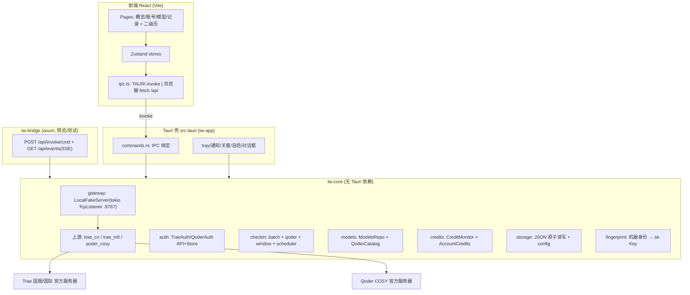

# TraeWork2API 桌面版（Tauri）技术设计

Feature Name: tauri-desktop-version
Updated: 2026-11-02
上游参考资料：`.monkeycode/analysis/*.md`（7 份实现级源码分析，协议/常量的唯一权威来源）
对应需求：`requirements.md`（R1–R12）；需求回写修正见文末「需求修正」。

## Description

把 Android 版 TraeWork2API（本地 OpenAI 兼容网关 + Trae/Qoder 双上游）移植为 Tauri v2 桌面应用。
Windows 优先实测，macOS/Linux 同工程可编译。业务与协议全部下沉 Rust `tw-core`（不依赖 Tauri），
Tauri 只做薄绑定（IPC/托盘/通知/自启），另用一个 `tw-bridge` HTTP 二进制复用同一 core，
实现浏览器预览与自动化集成测试。前端 React + Vite + TS，按 `ui-keepalive.md` 清单逐控件复刻。

功能对应关系（Android 机制 → 桌面处置）：

| Android | 桌面版 |
|---|---|
| MainActivity（原生 View） | React 页面：概览/账号/模型/记录 4 页签 + 常驻设置(桌面体检)/外观 2 二级页 |
| LocalFakeServer（线程 Socket） | tokio TcpListener + 手写 HTTP/1.1（输出逐字节对齐 Android：CORS 四头、Connection: close、SSE 帧形） |
| SharedPreferences（8 个 prefs 文件） | 应用数据目录 JSON 存储（atomic write），prefs×key 一一映射（§Data Models） |
| 前台服务/常驻通知/看门狗/唤醒锁/划掉拉回 | 托盘常驻 + tooltip「端口 8787」+ 关窗最小化到托盘（默认开）；其余丢弃 |
| AlarmManager 双闹钟 | tokio 调度任务：用户 HH:mm（Trae 08:00 默认 / Qoder 09:00 默认）+ SGT 10:05 开窗补签 + 启动补跑 |
| Widevine+APK签名 → sk- 派生 | OS 机器指纹（Win MachineGuid / mac IOPlatformUUID / Linux machine-id）→ 同式 sha256 派生；兜底持久 device_identity |
| 开机自启（Android 刻意不做） | 保持同决策：tauri-plugin-autostart **默认关**，UI 显式开关 |
| SAF 导出/导入 | tauri-plugin-dialog 文件选择 + core export/import（格式与 Android 备份一致） |

## Architecture



要点：
1. **core 单例状态**：`OnceLock<Arc<Core>>`，含 `RwLock` 配置缓存、两把锁（Trae `ReentrantMutex`——批量签到全程持锁且嵌套续期；Qoder 独立 `Mutex`，与 Trae 永不互相阻塞）。锁语义对齐 `Gateway.locked/lockedQoder`。
2. **网关服务**独立 tokio 任务，启停幂等（对齐「已在跑直接 return」，防 EADDRINUSE）。
3. **事件流**：core 定义 `Emitter` trait（`emit(topic, serde_json::Value)`）；Tauri 侧接 `AppHandle::emit`，bridge 侧接 SSE hub。事件：`service-state`、`credits-snapshot`、`checkin-result`、`models-updated`、`autocheckin-toast`。
4. **双二进制**：`tw-app`（tauri 窗口 + 托盘）与 `tw-bridge`（同端口 8787 起网关 + 8790 起 IPC）。浏览器预览时 Vite dev 代理 `/api → 127.0.0.1:8790`（frontend-reverse-proxy 规则），同一份 `ipc.ts`。

## Components and Interfaces

### 源码→模块映射（tw-core/src/）

| Kotlin | Rust 模块 | 备注 |
|---|---|---|
| LocalFakeServer.kt | `gateway/server.rs` `gateway/http1.rs` `gateway/sse.rs` | 手写 HTTP/1.1（行解析、content-length/chunked/close 三种取体、8MiB 上限），逐字节响应格式对齐 analysis §1.7 |
| Gateway.kt | `gateway/mod.rs` | 启停装配、providers 接线、两把锁、api_key |
| GatewayBackend.kt | `gateway/backend.rs` | trae/qoder/auto 选择、routeFor（Trae 优先）、modelsFor 并集+owned_by |
| GatewayService.kt | （删除）→ `app/tray.rs` + `storage/service_intent.rs` | 仅保留 should_run 三态意图语义 |
| TraeUpstream/TraeIntlUpstream/TraeRegion | `upstream/trae.rs` `upstream/trae_intl.rs` `upstream/region.rs` | 请求头/prepareBody/SSE 映射/错误分类逐条对齐 analysis；区域每次请求快照，不读全局 |
| QoderUpstream/QoderCosyCrypto/QoderMachine | `upstream/qoder.rs` `crypto/cosy.rs` `crypto/machine.rs` | 自定义 base64 表、swapOuterThirds、MD5 签名、AES-128-CBC/PKCS7、RSA-1024-PKCS1v15（手动 EM）、reverseMask UUID；显式清空 UA 与 MachineToken/MachineType 头 |
| TraeAuthApi/QoderAuthApi | `auth/trae_api.rs` `auth/qoder_api.rs` | 阈值单位分离：Trae `Duration`（秒域）、Qoder `UnixMillis` 新类型 |
| TraeAuthStore/QoderAuthStore | `auth/trae_store.rs` `auth/qoder_store.rs` | 字段与 key 按 analysis/auth-stores §3.2/§4.5 |
| BatchCheckin/QoderCheckin/AutoCheckin+3 Receiver | `checkin/{batch,qoder,window,scheduler}.rs` | 成功判据合取统一用 BatchCheckin 版；调度用 tokio 循环替代闹钟 |
| CreditMonitor/AccountCredits | `credits/{monitor,account}.rs` | 60s/平台节流、urgent 跳节流仍盖时间戳、见底阈值下限 5 |
| ModelsRepo/QoderModelCatalog/QoderModelCache | `models/{repo,qoder_catalog,qoder_cache}.rs` | 内置 21 条快照以 JSON 常量嵌入；三级降级；`qoder_catalog_auto_tried` 进程闸 |
| UsageStore | `usage.rs` | FIFO 100 条、字段 `ts/model/prompt/completion/total/ms/ok/err` |
| AccountBackup | `backup.rs` | 外壳 `{format:"traework2api-backup",version:1,trae,qoder}` 原样复用 |
| AppStyle/MainActivity/res | `frontend/`（React） | 19 键 ×4 风格 ×2 模式色表逐 hex 迁移；FS token 数值同表 |
| KeepAlive+体检面板 | `desktop/checks.rs` + 前端「常驻设置」页 | 6 项重定义为桌面等值（§桌面体检） |
| repairMislabeledRegions 等历史修补 | 不移植 | uid 长度覆写属 Android 迁移包袱 |

### IPC 契约（Tauri command 与 bridge 端点一一对应：`POST /api/invoke/<cmd>`，请求体=参数 JSON，响应 `{ok:true,data}` / `{ok:false,error}`）

service：`service_status`(→{running,busy,shouldRun,hasUserIntent,port}) `service_start` `service_stop` `api_key`(→String) `lan_address`(→[String])
trae：`trae_state`(→{logged:TraeAccountView[],activeUid,regionId,authFailedUid,forwardState文案所需字段}) `trae_login_url`(region→String) `trae_login_submit`(url→LoginResult) `trae_switch`(uid) `trae_remove`(uid) `trae_region_set`(id) `trae_diagnose`(→String)
qoder：`qoder_state` `qoder_login_pat`(pat,mode→{ok,name?,error?}) `qoder_switch` `qoder_remove` `qoder_diagnose` `qoder_fingerprint_get/set/clear` `qoder_machine_id`
backend：`backend_get/set`(trae|qoder|auto)
credits：`credits_snapshot` `credits_refresh_all`(force→Summary) `checkin_claim_all`(→BatchSummary) `qoder_claim_all`(→QoderSummary) `qoder_claim_one`(uid) `checkin_schedule_get/set`(enabled,hhmm,platform∈{trae,qoder}) `auto_switch_get/set`(enabled,threshold)
models：`models_view`(→{loaded,items:[{id,name,source:trae|qoder,multiplier?,free,verified,context?,aliases?}],counts}) `models_refresh_trae`(→FetchResult) `models_sync_qoder`
records：`records_get`(→{items,agg})（记录页只读展示，聚合规则同 UsageStore.aggregate）
backup：`backup_export`(→{path}) `backup_import`(→{traeN,qoderN})（dialog 选路径后可选直传 data）
desktop：`style_get/set`(styleId,modeId∈light|dark|system) `close_to_tray_get/set` `autostart_get/set`(默认 false) `desktop_checks`(→CheckItem[6]{title,ok,why,autoFixable}) `app_version`
事件：`service-state`、`credits-snapshot`、`checkin-result`{platform,summary}、`models-updated`、`notice`{text}（应用内 toast）
命令实现全部为 core 的 `ipc/mod.rs` 纯函数；`tw-app` 用 `#[tauri::command]` 宏逐一转发，`tw-bridge` 用宏生成的命令路由表转 HTTP。**单一注册表** `commands.rs!` 宏列名，保证两侧不漂移。

### 上游超时/重试基线（与 Android 一致）
connect 20s / read 180s；换号最多 2 个、仅未出 `"choices"` 帧前、401/403 先同账号强制续期一次；错误分类表逐条照抄 `gateway-server.md §3.4`（含 `queued:` 换号不续期、非数字码保守换号）。

### 前端结构
`frontend/src/`：`App.tsx`（styleProvider+nav+toast栈）→ `pages/{overview,account,models,records,keepalive,style}.tsx`；原子组件按 `ui-keepalive.md §8.1` 清单；全局态用 zustand 切片（uiStyle/nav/trae/qoder/credits/service/models/records）；「原地更新不重建」用局部 state + memo 子树，禁止整页 remount 表达刷新。样式 CSS 变量 `--tw-*`（19 键 ×8 表原样 hex 迁移，`moss` 苔绿、`sunset` 落日等 4 风格名沿用），字号/圆角/间距 token 同表（FS 数值直作 px）。文案全部按 `ui-keepkeep.md §2/§3` 原样中文，toast 8 态、签到按钮 8 文案×3 外观、积分三态 `… / — / —（原因）` 逐一对应。

## Data Models

应用数据目录（Tauri `app_data_dir`；bridge 用 `--data-dir` 参数）：

```
<data>/
  config.json                  # gateway_backend, trae_region, auto_switch{enabled,threshold=5},
                               # checkin:{trae_enabled,trae_time=08:00,qoder_enabled,qoder_time=09:00},
                               # style:{styleId,modeId}, close_to_tray(默认 true), autostart(默认 false), app_install_id
  service.json                 # {should_run, has_user_intent}（三态意图）
  accounts.trae.json           # {version, activeUid, accounts:[TraeCred…]} 字段同 TraeAuthStore
  accounts.qoder.json          # {version, activeUid, accounts:[QCred…]} 字段同 QoderAuthStore
  models.trae.json             # Trae 模型表 OpenAI 数组原文（空表拒覆盖）
  catalog.qoder.json           # {dynamic:[QModel…]} 合并后目录
  usage.json                   # [UsageRecord]（FIFO≤100）
  credits.trae.json / credits.qoder.json  # 单卡额度 + authFailedUid 按 uid
  credits.cache.json           # AccountCredits cache_json+at（含合计所需）
  checkin.state.json           # {schedule_enabled,schedule_time,last_run_date,last_results} ×(trae/qoder 两段)
                               #   qoder_claimed:{uid→yyyy-MM-dd}, auto_checkin_done:{"trae:uid"/"qoder:uid"→date}, auto_checkin_last_try
  device_identity              # 兜底 UUID 文件（0600），仅机器指纹不可读时使用
```

prefs→文件映射以 `checkin-credits.md §7.3` 与 `auth-stores.md §3.2/§4.5` 为准，key 名保持不变（审计友好）。旧 prefs 中的 `local_api_key`、`trae_token` 在桌面版**不存在**（无迁移负担）。

核心结构体（Rust，字段命名=Kotlin）：
```rust
struct TraeCred { access_token, refresh_token /*轮换*/, expires_at: i64 /*Unix秒,0=未知*/, uid, nickname, region_id /*"cn"|"sg"，仅 cn 受支持*/ }
struct QCred { pat, job_token, job_refresh_token, expires_at: UnixMillis, uid, name, email, mode /*cn|global*/, organization_id, organization_name, organization_tags, data_policy_agreed, is_data_policy_modifiable }
struct QModel { key, name, aliases, price_factor: Option, reasoning, context }   // openAiModels()→ id/owned_by=qoder…
struct UsageRecord { ts, model, prompt, completion, total, ms, ok, err }
struct CheckItem { title, ok, why, auto_fixable }
```
本地 API Key：`sk-` + `sha256("<fingerprint>")` 前 32 hex；`<fingerprint>` = Windows 注册表 MachineGuid、macOS IOPlatformUUID、Linux /etc/machine-id（`sha256("tm:" + raw)` 作为 deviceId 输入，对齐 Android `派生|不落盘` 两性质）。自检：非空、`sk-`、长 35、两次取值相等。

## Correctness Properties

1. `/v1/models` 恒等于 `merge(trae, qoder)` 规则产物；并集中 owned_by 必在；id 去重后 Trae 在前。
2. auto 路由：同名模型 → Trae；未命中两侧 → Trae；仅 Qoder → 全部 Qoder。
3. refresh/jobToken 轮换串行：同一平台并发续期后库中 token 恰好被替换一次（防令牌重放双保险：先读库、他人已续则复用、refreshToken 变更则放弃写回）。
4. API Key 跨重启恒定（同机）；网关鉴权与上游凭证相互独立。
5. 定时任务只在转发后查额度（无请求时上游零轮询）；urgent 立刻、成功 60s 节流但均盖时间戳。
6. 签到判据合取 `code==0 ∧ after.checked_in ∧ before≠signed`；设备三件套派生（SHA-256 计数器流：15 位数字 id/64hex sess/UUIDv4 market）与官方逐字节一致（单测向量照抄 trae-upstream 分析实测断言）。
7. 备份导出→导入 round-trip 后账号集合不变（Property test）。
8. SSE 输出：首帧前失败可换号；一旦写出响应头（200）后续错误只允许流内 `event: error` + `[DONE]`（客户端看到的状态码恒 200——刻意对齐 Android）。

## Error Handling

- IPC 错误统一 `{ok:false,error:"<原 Android toast 级中文文案>"}`，前端按 §文案表展示；登录失败/续期失败按 uid 记「需重新登录」并随账号卡显示。
- 网关对客户端：OpenAI 风格错误体（形状照 `gateway-server.md §2.2` 7 种）；无 Trae 凭证→200 fakeCompletion、无 Qoder 凭证→502 upstream_unavailable（**保持这个不对称**）。
- 端口占用 → start 返回 `EADDRINUSE` 中文文案（不 panic）；数据文件损坏 → 该文件回默认值自愈（对齐 prefs 容错），损坏副本改名 `*.corrupt-<ts>` 留存。
- 上游断连污染已开头发出的流（Android 已知缺陷）→ 桌面修复：写出响应头后的任何异常必须收敛为一条 `event: error` 帧 + `[DONE]`（需求 R1.4，唯一授权的"更正确"偏差）。Qoder transport 错误路径补发 `[DONE]`（同类修复）。
- 托盘/通知/自启 API 失败 → 静默降级 + `desktop_checks` 对应项标未就绪，不影响网关。

## 桌面体检（常驻设置页，6 项，替代保活面板）

| 项 | ok 判据 | 文案基调 |
|---|---|---|
| 网关运行 | isRunning 且端口探测 8787 | 通过/「未启动→去启动」 |
| 端口监听可复现 | 发一次 /healthz | 通过/「被占用（给建议）」 |
| 托盘常驻 | tray 构建成功 | Android「常驻通知」等值 |
| 关窗后台运行 | close_to_tray=true | 「一次只跳一个设置」改为直达该开关 |
| 系统通知 | notification 权限/可发 | 定时签到通知等值 |
| 开机自启（可选，默认关） | autostart 状态 | 「需手动」项之一（Linux 桌面环境差异等值项） |
每项形状 `CheckItem{title,ok,why,auto_fixable}` 与 Android 面板一致；一键配置按 auto_fixable 顺序引导（每点一次只处理一项）。

## Build & Run

```
desktop/
  Cargo workspace: crates/tw-core, crates/tw-bridge, apps/tw-app(src-tauri), frontend/(vite+react)
  scripts/build-desktop.ps1      # Windows: pnpm/npm ci → tauri build → out/TraeWork2API-desktop-setup-<ver>.exe
  npm run dev / npm run dev:bridge   # 本地预览：vite(5173,/api→8790) + tw-bridge(8787 网关+8790 IPC)
  npm run build                  # tsc + vite build → frontend/dist（tauri 前打包资源）
  cargo test -p tw-core          # 全部 selfCheck 向量 + 分类表 + 聚合/派生单测
```
tauri.conf：窗口 720×900（min 560×720，content-max 640 居中留白）、title TraeWork2API、图标由 `ic_launcher_foreground` 白箭头重绘为 svg/ico；bundle targets：Windows `nsis+msi`，Linux `deb+appimage`，mac `dmg`；CSP 允许 connect-src `http://127.0.0.1:8790 self`（bridge IPC）与实际 host 白名单外流量**仅**发生在 Rust 侧（不违反 CSP：上游请求不经过 webview）。

## Test Strategy

1. **向量级单测**（最高优先，直接决定"功能一模一样"）：逐条翻译 analysis 中 selfCheck 断言为 `#[test]`：COSY（b64 回环/签名 4LF 结构/AES 向量/RSA 模幂/reverseMask UUID 格式/两个不同 request_id）、设备三件套派生实测向量、错误分类 12 边界、chunked/中文 body 按字节、aggregateChunks（含 arguments 分片合并、finish_reason 最后非空）、SG deltaOf 六条、模型表过滤/回落正则、routeFor 矩阵、sk 派生确定性与长度 35、AppStyle 对比度 ≥4.5（TS 测试）。
2. **备份 round-trip**、usage FIFO 100、credits 合计只计成功、定时判据（模拟时钟下补签/自续一次不重不漏）。
3. **桥接集成测试**：tw-bridge + 假上游（本地 mock server 注入 endpoint override，仅测试构建 feature `test-mock` 打开时可用）走 SSE/非流式/401→续期→换号→回滚全链路。
4. 前端：vitest 组件冒烟（渲染四页签、token 表加载）+ 手测清单（ui-keepalive 第 9 节 9 条验收点逐条勾）。
5. Windows 真机（用户侧）：安装→登录→转发→签到→关窗托盘→重启 key 不变 checklist；`.github/workflows/desktop-build.yml` 三平台 CI 产物。
上游真实协议无测试账号则不可 CI 化；以向量 + mock 为主，live smoke 由用户在 Windows 执行。

## 需求修正（回写 requirements.md 依据）

- R9.3 开机自启：Android 版刻意不做（用户历史决策）。桌面版保留为**默认关**的可选开关（非默认开），R9 措辞相应修正为"可选、默认关"。
- R6.4 "2/3 个账号"计数标注：该文案已从现版 Android 移除，桌面版对齐现版代码：合计仅累加查询成功账号，全空显示 `—`，单卡失败 `—（原因）`。
- R10.1 "五个页签"：更正为 4 页签 + 2 二级页（以代码实况为准，README 描述过期）。
- R6.2 签到定时：实现为三链路（用户 HH:mm Trae/Qoder 两闹钟 + SGT 10:05 开窗补签 + 启动补跑），通知仅定时路径且新增成功数 > 0。
- R1 补一条授权偏差：已发响应头后的异常必须收敛为流内错误帧（修复 Android 已知污染缺陷）；Qoder 错误路径补 `[DONE]`。

## References

- (analysis) `/.monkeycode/analysis/gateway-server.md` §1–§7（HTTP/路由/SSE/providers/常量）
- (analysis) `/.monkeycode/analysis/trae-upstream.md` §1–§9（区域/CN 协议/SG 三段/UG 头/向量）
- (analysis) `/.monkeycode/analysis/qoder-cosy.md` §1–§4（base64 表/签名/运行时字段/信封）
- (analysis) `/.monkeycode/analysis/auth-stores.md` §1–§4（登录/续期/存储 key）
- (analysis) `/.monkeycode/analysis/checkin-credits.md` §1–§9（签到判据/调度/prefs 全表）
- (analysis) `/.monkeycode/analysis/models-usage-backup.md` §1–§6（21 条内置快照 JSON）
- (analysis) `/.monkeycode/analysis/ui-keepalive.md` §0–§9（页面清单/色表/交互点/验收）
- (Kotlin#源码) `app/src/main/java/com/example/traework2api/` 全目录
- (外部) Sliverkiss/traework2api（Go 参考实现，README 致谢）
